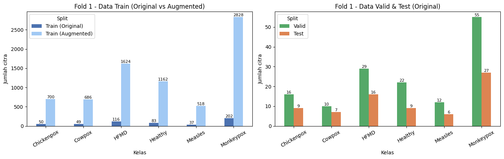

# Klasifikasi Citra Lesi Kulit Monkeypox (MSLD v2.0)

**Studi Kasus Pembelajaran Mesin, Minggu 10**
Perbandingan tiga arsitektur deep learning, yaitu **SimpleCNN**, **ModifiedCNN**, dan **MobileNetV3-Small**, untuk mengklasifikasikan citra kulit ke dalam 6 kelas: *Chickenpox*, *Cowpox*, *HFMD*, *Healthy*, *Measles*, dan *Monkeypox*.

**Anggota kelompok:**
- Gede Bagus Narindra Utama
- Razfathian Fadrisnain Adhira
- Naufal Rafif Yumna

Program Studi Sains Data, Telkom University Surabaya

---

## Daftar Isi
1. [Latar Belakang](#1-latar-belakang)
2. [Dataset](#2-dataset)
3. [Exploratory Data Analysis](#3-exploratory-data-analysis)
4. [Pre-processing](#4-pre-processing)
5. [Arsitektur Model](#5-arsitektur-model)
6. [Konfigurasi Pelatihan](#6-konfigurasi-pelatihan)
7. [Hasil](#7-hasil)
8. [Analysis and Discussion](#8-analysis-and-discussion)
9. [Kesimpulan](#9-kesimpulan)
10. [Struktur Repositori & Cara Menjalankan](#10-struktur-repositori--cara-menjalankan)

---

## 1. Latar Belakang

Kasus MonkeyPox (mpox) meningkat di berbagai negara dan berpotensi meluas. Penularan dapat dicegah jika pembawa virus (*carrier*) teridentifikasi sejak dini, tetapi ruam mpox stadium awal sering mirip dengan penyakit kulit lain seperti cacar air, cacar sapi, campak, dan HFMD, sedangkan jumlah tenaga ahli terbatas. Proyek ini membangun model klasifikasi citra kulit yang dapat membedakan kulit **sehat**, **MonkeyPox**, dan **penyakit kulit lain** secara otomatis.

## 2. Dataset

**Mpox Skin Lesion Dataset Version 2.0 (MSLD v2.0)**: [Kaggle](https://www.kaggle.com/datasets/joydippaul/mpox-skin-lesion-dataset-version-20-msld-v20/data)

> Dataset **tidak diunggah** ke repositori ini sesuai ketentuan tugas. Silakan unduh dari tautan di atas.

Dataset terdiri dari 755 citra asli dalam 6 kelas, yang sudah dibagi ke dalam 5 fold.

| Kategori | Isi | Penggunaan |
|---|---|---|
| Original Images | 5 fold, masing-masing berisi `Train`, `Valid`, `Test` | `Train` untuk pelatihan, `Valid` untuk validasi, `Test` untuk pengujian |
| Augmented Images | 5 fold, hanya berisi `Train` | `Train` untuk pelatihan |

**Skema pembagian data per fold (tanpa kebocoran data):**
- **Train** = Original `Train` + Augmented `Train`
- **Validation** = Original `Valid` saja
- **Test** = Original `Test` saja

Data `Valid` dan `Test` tidak pernah dipakai untuk pelatihan.

Contoh komposisi pada Fold 1:

| Kelas | Train (Original) | Train (Augmented) | Valid | Test |
|---|---:|---:|---:|---:|
| Chickenpox | 50 | 700 | 16 | 9 |
| Cowpox | 49 | 686 | 10 | 7 |
| HFMD | 116 | 1.624 | 29 | 16 |
| Healthy | 83 | 1.162 | 22 | 9 |
| Measles | 37 | 518 | 12 | 6 |
| Monkeypox | 202 | 2.828 | 55 | 27 |
| **Total** | **537** | **7.518** | **144** | **74** |

Jumlah citra test per fold: 74, 82, 64, 81, dan 63 (total 364 citra).

## 3. Exploratory Data Analysis

### Distribusi kelas


### Contoh citra tiap kelas


### Sebaran resolusi citra asli


Rata-rata ukuran citra asli 270 × 270 piksel (minimum 69 × 69, maksimum 2.448 × 2.448). Sebanyak 446 dari 755 citra (59%) sudah berukuran 224 × 224 piksel, sehingga semua citra di-*resize* ke 224 × 224.

## 4. Pre-processing

Tiga skema pre-processing dieksplorasi:

| Skema | Deskripsi |
|---|---|
| Tanpa pre-processing | Hanya *resize* 224 × 224 dan normalisasi ImageNet (baseline) |
| **CLAHE** (skema utama) | *Contrast Limited Adaptive Histogram Equalization* pada kanal L (ruang warna LAB), *clip limit* 2,0, petak 8 × 8. Mempertajam tekstur lesi tanpa mengubah warna kulit |
| Shades of Gray | *Color constancy* dengan norma Minkowski p = 6 untuk menormalkan warna dan pencahayaan |


**Augmentasi saat training (di GPU, per batch):**
- **SimpleCNN & ModifiedCNN**: *horizontal flip* (augmentasi ringan, karena model cenderung *underfitting*).
- **MobileNetV3-Small**: *horizontal flip* (p = 0,5), *vertical flip* (p = 0,2), rotasi ±20°, skala 0,75–1,0, serta perubahan kecerahan (±20%), kontras (±20%), dan saturasi (±15%) (augmentasi kuat, karena model cenderung *overfitting*).

## 5. Arsitektur Model

| Model | Deskripsi | Parameter |
|---|---|---:|
| **SimpleCNN** | 3 blok Conv–ReLU–MaxPool (32 → 64 → 128), *global average pooling*, 2 lapisan FC. *Baseline* dilatih dari nol. | 101.894 |
| **ModifiedCNN** | 4 blok konvolusi ganda (32 → 64 → 128 → 256) dengan BatchNorm, aktivasi SiLU, blok atensi **Squeeze-and-Excitation**, dan Dropout2d. Dilatih dari nol. | 638.558 |
| **MobileNetV3-Small** | *Transfer learning* dari bobot *pre-trained* ImageNet; lapisan klasifikasi akhir diganti Dropout (0,3) + Linear (6 kelas). | 1.524.006 |

> MobileNetV3-Small hanya memakai **bobot awal** hasil pre-training ImageNet. Seluruh *fine-tuning* dan evaluasi hanya menggunakan dataset MSLD v2.0.

## 6. Konfigurasi Pelatihan

| Parameter | SimpleCNN & ModifiedCNN | MobileNetV3-Small |
|---|---|---|
| Loss function | CrossEntropyLoss + *class weight* + *label smoothing* 0,1 | sama |
| Optimizer | AdamW (*weight decay* 0,01) | sama |
| Learning rate | 0,001 | 0,0001 |
| LR scheduler | Cosine Annealing | sama |
| Epoch maksimum | 25 | 15 |
| Early stopping | *patience* 5 (berdasarkan Macro F1 validasi) | sama |
| Batch size | 64 | 64 |
| Lainnya | AMP FP16, GPU NVIDIA Tesla T4, seed 42 | sama |

- *Class weight* dihitung dari data train tiap fold dengan rumus `w_c = N / (K × N_c)`, sehingga kelas yang jumlahnya sedikit mendapat bobot lebih besar (contoh Fold 1: Measles 2,42; Monkeypox 0,44).
- Bobot model terbaik di tiap fold dipilih berdasarkan **Macro F1 validasi**, lalu dievaluasi pada data test.
- Metrik evaluasi: **Accuracy, Macro Precision, Macro Recall, Macro F1-Score, Macro ROC-AUC (One-vs-Rest), dan Confusion Matrix**, dengan **rata-rata 5-fold**.

## 7. Hasil

### 7.1 Rata-rata 5-fold (skema CLAHE)

| Model | Split | Accuracy | Precision | Recall | F1-Score | ROC-AUC |
|---|---|---:|---:|---:|---:|---:|
| SimpleCNN | Validation | 0,4715 | 0,4486 | 0,4911 | 0,4424 | 0,7833 |
| SimpleCNN | **Test** | 0,4679 | 0,4446 | 0,4536 | 0,4200 | 0,7720 |
| ModifiedCNN | Validation | 0,5860 | 0,5701 | 0,6323 | 0,5790 | 0,8627 |
| ModifiedCNN | **Test** | 0,6035 | 0,5816 | 0,6020 | 0,5688 | 0,8623 |
| MobileNetV3-Small | Validation | 0,7718 | 0,7661 | 0,7855 | 0,7677 | 0,9469 |
| MobileNetV3-Small | **Test** | **0,7660** | **0,7692** | **0,7664** | **0,7535** | **0,9495** |


### 7.2 Kurva training & validation


### 7.3 Confusion matrix (akumulasi test set 5-fold, 364 citra)


### 7.4 Kurva ROC-AUC (One-vs-Rest)


### 7.5 Eksplorasi pre-processing (MobileNetV3-Small, test set, mean ± SD 5-fold)

| Skema | Accuracy | Precision | Recall | F1-Score | ROC-AUC |
|---|---:|---:|---:|---:|---:|
| Tanpa pre-processing | 0,7873 ± 0,0534 | 0,7995 ± 0,0634 | 0,7649 ± 0,0513 | 0,7678 ± 0,0518 | 0,9518 ± 0,0200 |
| CLAHE | 0,7660 ± 0,0598 | 0,7692 ± 0,0671 | 0,7664 ± 0,0353 | 0,7535 ± 0,0502 | 0,9495 ± 0,0185 |
| Shades of Gray | 0,7724 ± 0,0680 | 0,7545 ± 0,0901 | 0,7725 ± 0,0646 | 0,7533 ± 0,0779 | 0,9462 ± 0,0216 |


## 8. Analysis and Discussion

### 1. Bagaimana karakteristik distribusi data pada setiap kelas?

Distribusi kelas **tidak seimbang**. Dari 755 citra asli, Monkeypox merupakan kelas terbanyak (37,6%), diikuti HFMD (21,3%), Healthy (15,1%), Chickenpox (9,9%), Cowpox (8,7%), dan Measles sebagai kelas paling sedikit (7,3%). Rasio kelas terbanyak terhadap tersedikit mencapai **5,16 : 1**. Ketimpangan ini membuat model cenderung menebak kelas mayoritas, sehingga digunakan *class weight* pada fungsi loss. Pola yang sama juga terlihat pada data augmentasi, karena setiap citra asli diperbanyak dengan rasio yang kurang lebih sama.

### 2. Preprocessing apa yang digunakan dan bagaimana pengaruhnya terhadap hasil klasifikasi?

Semua citra di-*resize* ke 224 × 224 piksel dan dinormalisasi dengan statistik ImageNet. Skema utama memakai **CLAHE** pada kanal L (ruang warna LAB) untuk mempertajam tekstur lesi. Sebagai pembanding, MobileNetV3-Small juga dilatih dengan **tanpa pre-processing** dan **Shades of Gray**.

Hasilnya, ketiga skema memberikan performa yang **sebanding** (Tabel 7.5). Tanpa pre-processing memang mendapat rata-rata tertinggi (akurasi 78,73%, F1 76,78%), tetapi selisihnya terhadap CLAHE dan Shades of Gray hanya sekitar 1–2 poin, lebih kecil dari simpangan baku antar-fold (±5–7 poin). Artinya, pre-processing tambahan **tidak memberi peningkatan yang berarti** pada MobileNetV3-Small. Dugaan kami, bobot *pre-trained* ImageNet sudah terbiasa dengan warna dan kontras alami, sehingga perubahan kontras atau warna tidak banyak membantu.

### 3. Apakah model mampu mengklasifikasikan keenam kelas dengan baik?

**Belum untuk semua kelas.** Recall per kelas pada test set (akumulasi 5-fold), dihitung dari confusion matrix:

| Kelas | SimpleCNN | ModifiedCNN | MobileNetV3-Small |
|---|---:|---:|---:|
| HFMD | 67% | 71% | **95%** |
| Healthy | 60% | 72% | **92%** |
| Measles | 17% | 43% | **80%** |
| Monkeypox | 40% | 52% | **66%** |
| Cowpox | 34% | 57% | **63%** |
| Chickenpox | 40% | **62%** | 57% |

MobileNetV3-Small sangat baik pada HFMD dan Healthy, tetapi masih lemah pada Chickenpox, Cowpox, dan Monkeypox. AUC per kelas MobileNetV3-Small berada di atas 0,92 untuk lima kelas, kecuali **Monkeypox (0,894)** yang justru menjadi kelas dengan AUC terendah. SimpleCNN bahkan hampir tidak bisa mengenali Measles (AUC 0,496, setara tebakan acak).

### 4. Kelas apa yang paling sering mengalami kesalahan klasifikasi?

- **Monkeypox dan Chickenpox** paling sering tertukar. Pada MobileNetV3-Small, 16 citra Monkeypox diprediksi sebagai Chickenpox dan 12 citra Chickenpox diprediksi sebagai Monkeypox. Kedua penyakit ini sama-sama berupa vesikel/pustula sehingga tampak mirip.
- Sebanyak **9 citra Monkeypox diprediksi Healthy**. Ini kesalahan paling berisiko untuk skrining karena pasien mpox bisa lolos.
- Pada model custom, **Measles** adalah kelas tersulit (recall SimpleCNN hanya 17%), karena jumlah datanya paling sedikit; citra Measles paling sering diprediksi sebagai HFMD (11 dari 30 citra).

### 5. Bagaimana hasil evaluasi pada masing-masing fold?

Macro F1 validasi terbaik pada tiap fold:

| Model | Fold 1 | Fold 2 | Fold 3 | Fold 4 | Fold 5 | Rata-rata |
|---|---:|---:|---:|---:|---:|---:|
| SimpleCNN | 0,3891 | 0,5166 | 0,4741 | 0,4100 | 0,4223 | 0,4424 |
| ModifiedCNN | 0,6236 | 0,5700 | 0,5634 | 0,6279 | 0,5100 | 0,5790 |
| MobileNetV3-Small | 0,7380 | 0,8153 | 0,7257 | 0,7886 | 0,7711 | 0,7677 |

<!-- [ISI] Jika sudah menampilkan skor TEST per fold dari df_folds_all, tambahkan tabelnya di sini. -->

MobileNetV3-Small paling stabil (0,73–0,82 di semua fold). Model custom lebih bervariasi antar-fold, misalnya SimpleCNN berkisar 0,39–0,52. Fold 2 memberi skor tertinggi untuk SimpleCNN dan MobileNetV3-Small. Variasi ini wajar karena data validasi per fold hanya sekitar 140 citra, sehingga beberapa citra yang salah saja sudah menggeser skor cukup besar.

### 6. Bagaimana hasil rata-rata evaluasi dari kelima fold?

Pada test set (Tabel 7.1), **MobileNetV3-Small** unggul di semua metrik dengan akurasi **76,60%**, Macro F1 **75,35%**, dan Macro ROC-AUC **0,9495**. ModifiedCNN berada di posisi kedua (akurasi 60,35%, F1 56,88%), naik 13,56 poin akurasi dibanding SimpleCNN (46,79%, F1 42,00%) berkat BatchNorm, aktivasi SiLU, dan blok atensi SE. Selisih akurasi validasi dan test MobileNetV3-Small hanya 0,58 poin, sehingga performanya konsisten pada data yang belum pernah dilihat.

### 7. Apa kelebihan dan keterbatasan model yang dikembangkan?

**Kelebihan:**
- Skema data tanpa kebocoran: validasi dan test hanya memakai citra asli.
- MobileNetV3-Small ringan (1,52 juta parameter) dengan Macro ROC-AUC 0,95, sehingga berpotensi dijalankan di perangkat dengan sumber daya terbatas.
- *Class weight* membantu kelas minoritas, misalnya recall Measles mencapai 80% pada MobileNetV3-Small.
- Evaluasi 5-fold dan studi ablasi pre-processing membuat hasil lebih dapat dipercaya.

**Keterbatasan:**
- Recall Monkeypox baru 66% dan masih ada 9 kasus yang terbaca Healthy, sehingga belum cukup untuk skrining nyata.
- MobileNetV3-Small mengalami *overfitting* (akurasi latih sekitar 97% vs validasi sekitar 77%), sedangkan model custom mengalami *underfitting*.
- Citra augmentasi berasal dari foto yang sama, sehingga variasi data sebenarnya terbatas; data validasi per fold juga kecil (sekitar 140 citra).
- Perbandingan model belum sepenuhnya setara karena MobileNetV3-Small mendapat augmentasi lebih kuat dan *learning rate* berbeda.
- Belum ada visualisasi Grad-CAM untuk memastikan model benar-benar fokus pada area lesi.

## 9. Kesimpulan

1. **MobileNetV3-Small** memberikan performa terbaik dengan akurasi 76,60%, Macro F1 75,35%, dan Macro ROC-AUC 0,9495.
2. **ModifiedCNN** (BatchNorm, SiLU, SE) mengungguli SimpleCNN dengan selisih akurasi 13,56 poin, menunjukkan bahwa perbaikan arsitektur membantu mengurangi *underfitting*.
3. **Pre-processing** tambahan (CLAHE, Shades of Gray) tidak memberi peningkatan yang berarti pada MobileNetV3-Small.

**Saran pengembangan:** menambahkan Grad-CAM, meningkatkan recall Monkeypox (misalnya dengan *focal loss* atau penyesuaian *threshold*), dan menguji model pada perangkat mobile.

## 10. Struktur Repositori & Cara Menjalankan

```
.
├── TUGAS_WEEK_10_pt4.ipynb    # source code lengkap (Google Colab)
├── README.md                  # laporan
└── outputs/                   # gambar hasil training & testing
    ├── eda_*.png
    ├── comparison_3models_bar.png
    ├── training_curves_*.png
    ├── confusion_matrix_custom_models.png
    ├── roc_auc_custom_models.png
    └── preprocessing_ablation.png
```

**Cara menjalankan:**
1. Unduh dataset MSLD v2.0 dari Kaggle, kompres menjadi `Dataset_Mpox.zip`, lalu simpan di Google Drive (`MyDrive/Dataset_Mpox.zip`).
2. Buka notebook di Google Colab dan aktifkan GPU (*Runtime → Change runtime type → GPU*).
3. Jalankan semua sel secara berurutan.
4. Grafik hasil tersimpan di folder `/content/outputs`.

> Sesuai ketentuan tugas, file bobot model (`*.pth`) dan dataset **tidak diunggah** ke repositori ini.
